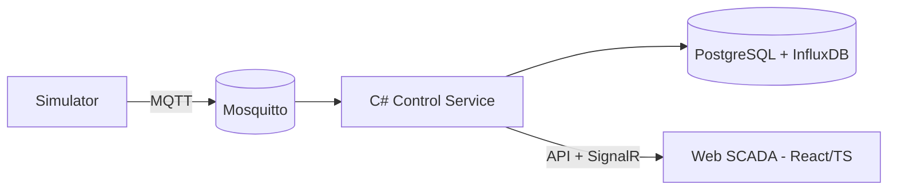

# Web SCADA — Đồ án tốt nghiệp

> **Trạng thái:** MVP đang phát triển. Máy dev hiện không có .NET SDK nên **chưa xác nhận build/test**; các lệnh bên dưới là quy trình chuẩn khi có SDK.

## Tổng quan

```text
Simulator (giả lập telemetry) --MQTT (tuỳ chọn)--> Mosquitto
      Mosquitto --MQTT--> C# Control Service
                           |-- PostgreSQL (cấu hình, alarm, command, audit)
                           |-- InfluxDB (telemetry)
                           |-- API + SignalR --> Web SCADA (React/TS)
```

> **Phạm vi mới:** chỉ tập trung **Web SCADA** và backend C# Control Service. Gateway ESP32/PLC thật **loại bỏ hoàn toàn**; simulator là nguồn dữ liệu.

## Mục tiêu chính

Web SCADA giám sát và điều khiển qua **C# Control Service** (ASP.NET Core): dashboard realtime, lịch sử, biểu đồ, alarm, command request. Dữ liệu do **simulator** cung cấp; không dùng Gateway ESP32 hay PLC thật.

## Phân quyền

| Thành phần | Làm gì | Không làm |
|---|---|---|
| **Simulator** | Phát telemetry/status/ack qua MQTT để dev/test | Không chạy web/C# |
| **C# Control Service** | MQTT ingest, DB (PostgreSQL + InfluxDB), alarm, command, audit, API + SignalR | Không thay Web SCADA |
| **Web SCADA (React/TS)** | Dashboard, lịch sử, alarm, command request qua API C# | Không publish MQTT `cmd` trực tiếp |
| **Mosquitto** | Broker MQTT (tuỳ chọn, cho simulator) | Không public Internet |
| **PostgreSQL + InfluxDB** | Metadata + telemetry | Không cho browser truy cập |

> **Quan trọng:** Chỉ C# Control Service publish `plc/<id>/cmd`. Web SCADA gửi command request qua API C#; simulator trả ack.

## Kiến trúc



**Luồng command:**
`Web SCADA → C# API → kiểm tra quyền/giá trị/interlock → audit → MQTT cmd → Simulator → ack → C# → realtime`

## Stack

### C# Control
- .NET 10 (Target `net10.0`)
- ASP.NET Core Web API + SignalR + Identity
- Worker Service / hosted background service
- MQTTnet (ingest simulator)
- EF Core + Npgsql
- InfluxDB.Client
- Serilog
- xUnit

### Web SCADA
- Mặc định: React + TypeScript + Vite
- SignalR JS client
- Nginx phục vụ static build
- Có thể thay bằng Node-RED/JS/Python; vẫn phải dùng API C# cho command

### Hạ tầng
- Docker Compose: Mosquitto, PostgreSQL, InfluxDB, C# API, Nginx
- Chỉ Web SCADA (browser) là giao diện vận hành; WPF ngoài phạm vi.

## Cấu trúc thư mục

```text
control-csharp/
  Control.slnx            # Solution file (net10.0)
  src/Control.Domain/     # Entities, Dtos, MqttContracts, CommandRules, AlarmRules
  src/Control.Infrastructure/  # EF Core (Data), Auth, Mqtt, Options, Telemetry (Influx/InMemory)
  src/Control.Api/        # ASP.NET Core API, Controllers, Hubs, BackgroundServices
  src/Control.Desktop/    # WPF Operator (ngoài phạm vi, giữ tham khảo)
  src/Control.Simulator/  # Giả lập nguồn telemetry/status/ack
  tests/Control.Tests/    # xUnit

web-scada/
  index.html
  vite.config.ts
  tsconfig.json
  Dockerfile
  nginx.conf
  src/
    main.tsx
    App.tsx
    api.ts
    auth.tsx
    types.ts
    useScadaHub.ts
    styles.css

deploy/
  docker-compose.yml
  mosquitto/
    mosquitto.conf

docs/
  README.md
  analysis/PHAN_TICH_DU_AN_VA_PHUONG_AN.md
  specs/CLAUDE_CODE_WEB_SCADA_SPEC.md
  specs/README_WEBSCADA.md
  presentation/brief_thiet_ke_powerpoint_iot_gateway.md
  thesis/                 # PDF/PPTX báo cáo
  assets/                 # Sơ đồ, hình ảnh

tools/
  dev-broker/             # MQTT broker dev (Aedes, cổng 1884)

scada/                    # Web SCADA legacy (chỉ tham khảo)

README.md
```

## Chạy nhanh (Docker)

```bash
cd deploy
docker compose up -d --build
```

| Dịch vụ | URL / Port |
|---|---|
| Web SCADA | http://localhost:5080 |
| C# API | http://localhost:5081 |
| MQTT | `localhost:1884` (cổng trong broker: 1883) |
| InfluxDB | http://localhost:8087 (cổng trong container: 8086) |

Tài khoản dev: `admin / Admin123!`

> **Lưu ý:** Đổi mật khẩu, JWT key, token InfluxDB và cấu hình MQTT trước khi dùng thật. Mosquitto trong `deploy/` đang để anonymous cho môi trường dev.

## Chạy local không cần Docker

Cần .NET SDK 10 + Node.js + npm.

### 1. MQTT broker dev

```bash
cd tools/dev-broker
npm install
npm start
```

Broker nghe cổng `1884`.

### 2. C# Control API

```bash
cd control-csharp
# Windows PowerShell
$env:Database__Provider="Sqlite"
$env:ConnectionStrings__Default="Data Source=control-dev.db"
$env:Mqtt__Host="localhost"
$env:Mqtt__Port="1884"
$env:Influx__Enabled="false"
dotnet run --project src/Control.Api --urls http://localhost:5081
```

`Influx__Enabled=false` dùng bộ nhớ tạm cho telemetry; khi Docker chạy thì dùng InfluxDB.

### 3. Simulator

```bash
cd control-csharp
$env:MQTT_HOST="localhost"
$env:MQTT_PORT="1884"
dotnet run --project src/Control.Simulator
```

Simulator phát telemetry 500 ms, status retained và trả ACK cho command.

### 4. Web SCADA

```bash
cd web-scada
npm install
npm run dev
```

Mở http://localhost:5173. Vite proxy `/api` và `/hubs` sang API `5081`.

## Build và kiểm thử

```bash
# C#
dotnet build control-csharp/Control.slnx -c Release
dotnet test control-csharp/Control.slnx -c Release

# Web
cd web-scada
npm ci
npm run build
```

## API chính

| Method | Endpoint | Mục đích |
|---|---|---|
| POST | `/api/auth/login` | Đăng nhập, nhận JWT |
| GET | `/api/gateways` | Danh sách Gateway |
| GET | `/api/gateways/{id}` | Chi tiết Gateway |
| GET | `/api/plcs` | Danh sách PLC |
| GET | `/api/tags` | Tag + giá trị mới nhất |
| PUT | `/api/tags/{id}` | Sửa cấu hình tag |
| GET | `/api/telemetry` | Lịch sử telemetry |
| GET | `/api/telemetry?tagId=` | Lọc theo tag |
| GET | `/api/alarms` | Danh sách alarm |
| POST | `/api/alarms/{id}/ack` | Xác nhận alarm |
| GET/POST | `/api/commands` | Danh sách / gửi lệnh |
| GET | `/api/commands/{id}` | Chi tiết lệnh |
| GET | `/api/audit` | Lịch sử audit |

**SignalR hub:** `/hubs/scada`

**Sự kiện:** `telemetry`, `gatewayStatus`, `alarm`, `commandStatus`.

## MQTT topic (contract)

| Topic | Chiều |
|---|---|
| `plc/<gateway_id>/telemetry` | Simulator → Control |
| `plc/<gateway_id>/status` | Simulator → Control |
| `plc/<gateway_id>/config` | Control → Simulator |
| `plc/<gateway_id>/cmd` | Control → Simulator |
| `plc/<gateway_id>/ack` | Simulator → Control |
| `plc/<gateway_id>/telemetry_ack` | Control → Simulator |

Payload dùng schema v1 (xem `control-csharp/src/Control.Domain/MqttContracts.cs`):

- **Telemetry:**
  ```json
  {
    "schema": "v1",
    "gateway_id": "GW_001",
    "plc_id": "PLC_001",
    "boot_id": "BOOT_0001",
    "seq": 1025,
    "ts": "2026-11-05T10:15:30Z",
    "quality": "good",
    "tags": { "X0": true, "D100": 1234 }
  }
  ```

- **Command:**
  ```json
  {
    "schema": "v1",
    "cmd_id": "CMD-0001",
    "gateway_id": "GW_001",
    "plc_id": "PLC_001",
    "target": "Y0",
    "value": 1,
    "ttl_ms": 3000
  }
  ```

- **Ack:**
  ```json
  { "schema": "v1", "cmd_id": "CMD-0001", "ok": true, "error": null, "ts": "2026-11-05T10:15:31Z" }
  ```

**Quy tắc:**
- QoS 1 cho telemetry/command/ack.
- Chỉ `config` và `status` retained.
- Simulator dùng LWT báo offline.
- `gateway_id` trong topic và payload phải khớp.
- Chống trùng telemetry bằng `(gateway_id, boot_id, seq)`.
- Chỉ C# Control publish `cmd` và gửi `telemetry_ack`.

## Dữ liệu tối thiểu (Entity)

| Entity | Fields quan trọng |
|---|---|
| **Gateway**: Id, Name, Location, Status, LastSeen |
| **Plc**: Id, GatewayId, Name, SlaveId, Enabled |
| **Tag**: Id, PlcId, Name, Address, DataType, Unit, Scale, Writable, Min/Max, Deadband, AlarmHigh, AlarmLow, Hysteresis |
| **AlarmEvent**: Id, TagId, Severity, Message, StartedAt, ClearedAt, AckAt, AckBy |
| **Command**: Id, CmdId, GatewayId, PlcId, TagId, Value, RequestedBy, Status, AckAt, Error |
| **AuditLog**: Id, UserId, Action, EntityType, EntityId, Detail, Timestamp |
| **Telemetry InfluxDB**: measurement `telemetry`, tags `gateway_id`, `plc_id`, `tag`, `quality`; field `value` |

## Thư mục quan trọng

- `control-csharp/src/Control.Api/Program.cs` — DI, hosted services (`MqttIngestionService`, `CommandTimeoutService`, `GatewayOfflineService`).
- `control-csharp/src/Control.Api/BackgroundServices/MqttIngestionService.cs` — N+1 fix, batch DB/Influx, Channel decouple, CancellationToken.
- `control-csharp/src/Control.Api/BackgroundServices/CommandTimeoutService.cs` — Load `pending` commands, timeout check, SignalR broadcast.
- `control-csharp/src/Control.Infrastructure/Mqtt/MqttService.cs` — Mqttnet client, EnsureConnected + resubscribe loop, PublishAsync.
- `control-csharp/src/Control.Infrastructure/Telemetry/TelemetryDeduplicator.cs` — Dedup theo `(gateway_id, boot_id)`.
- `control-csharp/src/Control.Domain/MqttContracts.cs` — Topic, record, schema v1.
- `web-scada/src/useScadaHub.ts` — SignalR client, reconnect/resubscribe.
- `web-scada/src/api.ts` — HTTP client gọi API C#, dùng chung `HttpClient` (không leak).
- `deploy/docker-compose.yml` — Services compose, depends_on + healthcheck, env.
- `appsettings.json` — Cấu hình MQTT, Influx, JWT, Admin.

## Phase triển khai (kế hoạch)

| Phase | Nội dung | Xong khi |
|---|---|---|
| 0 | Skeleton + Docker Compose + build | `dotnet build`, `npm run build`, `/health` OK |
| 1 | Web: login, layout, phân quyền | Đăng nhập, route bảo vệ |
| 2 | Web: dashboard + Gateway/PLC/Tag + SignalR realtime | Dữ liệu cập nhật không reload |
| 3 | Web: lịch sử + biểu đồ (Recharts) | Lọc theo tag/thời gian |
| 4 | Web: alarm + acknowledge | ACK cập nhật realtime |
| 5 | Web: command request + audit | Gửi lệnh, thấy trạng thái/ack |
| 6 | Hardening, test, tài liệu | Build/test/compose sạch, checklist đạt |

Ước lượng: 10–14 tuần (là mục tiêu lập kế hoạch, không phải kết quả đo).

## Nghiệm thu MVP

1. Simulator gửi telemetry vào C# Control.
2. Web SCADA đăng nhập, hiển thị dashboard realtime.
3. 8–16 tag có value/quality/timestamp, cập nhật qua SignalR.
4. Lịch sử + biểu đồ theo tag/khoảng thời gian.
5. Alarm + acknowledge.
6. Command từ Web → C# → simulator → ACK + audit.
7. Web SCADA build static + C# API.
8. `dotnet test`, `npm run build`, `docker compose up` pass.
9. Không phụ thuộc Gateway ESP32/PLC thật.

## Giới hạn hiện tại

- Không dùng Gateway ESP32/PLC thật; simulator là nguồn dữ liệu duy nhất.
- Chưa có TLS/HTTPS production; cần reverse proxy, chứng chỉ và MQTT credential.
- Mosquitto dev để anonymous; phải cấu hình tài khoản trước khi công khai.
- `Influx__Enabled=false` chỉ dùng cho dev; lịch sử nằm trong bộ nhớ và mất khi restart.
- Chưa có đầy đủ quản trị người dùng; admin được seed từ cấu hình.
- WPF Operator ngoài phạm vi (giữ tham khảo, không phát triển).

## Hướng phát triển

- Phân quyền nhiều vai trò (viewer/operator/admin) và quản lý người dùng.
- Xuất CSV/PDF cho lịch sử và alarm.
- Dashboard kéo-thả widget, dark mode, responsive.
- Đa ngôn ngữ (VI/EN) và thông báo alarm qua email/webhook.
- Tối ưu truy vấn lịch sử lớn (phân trang, downsample InfluxDB).

## Hợp đồng kỹ thuật (Technical Contracts)

- **Spec C# Control + Web SCADA:** `docs/specs/CLAUDE_CODE_WEB_SCADA_SPEC.md` (kiến trúc, topic, schema v1, API, phase).
- **Hướng dẫn chạy:** `docs/specs/README_WEBSCADA.md` (Docker/local, tài khoản dev, giới hạn).
- **Tài liệu tham khảo cũ (hardware/firmware):** `docs/analysis/PHAN_TICH_DU_AN_VA_PHUONG_AN.md` (ngoài phạm vi hiện tại).
- **Payload contract:** `control-csharp/src/Control.Domain/MqttContracts.cs`.

## Tác giả

Đồ án tốt nghiệp – Web SCADA cho hệ thống công nghiệp.

## License

MIT License — xem [`LICENSE`](LICENSE). Mục đích giáo dục/nghiên cứu.

## Trước khi push GitHub

- [ ] Không commit `.env`, `appsettings.Production.json`, token hay mật khẩu thật.
- [ ] Đổi `Jwt__Key`, `Admin__Password`, `Influx__Token` khỏi giá trị dev.
- [ ] Xác nhận `.gitignore` loại `bin/`, `obj/`, `node_modules/`, `*.db`, `.vs/`.
- [ ] Kiểm tra dung lượng `docs/thesis/*.pdf|pptx`; dùng Git LFS nếu tệp > 100 MB.
- [ ] Thêm ảnh dashboard/screenshot vào `docs/assets/` và chèn vào README nếu cần.
- [ ] Chạy `dotnet build`, `dotnet test`, `npm run build` khi có SDK.
- [ ] Điền mô tả repo + topics trên GitHub: `scada`, `react`, `typescript`, `vite`, `signalr`, `aspnet-core`, `mqtt`, `postgresql`.