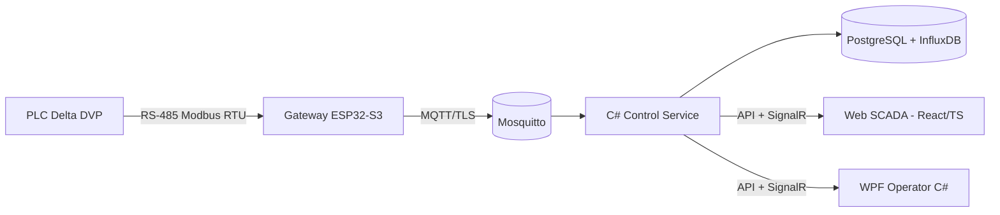

# BRIEF TRIỂN KHAI: C# CONTROL + WEB SCADA

> **Trạng thái: KẾ HOẠCH — CHƯA TRIỂN KHAI.**
> Đọc hết file này trước khi code. Không tự mở rộng phạm vi.

---

## 1. Mục tiêu

Làm 2 phần mềm độc lập:

1. **Phần mềm điều khiển hệ thống — C#**
   - Nhận telemetry MQTT từ Gateway.
   - Quản lý alarm, command, audit, lịch sử.
   - Cung cấp API + SignalR cho Web SCADA và WPF.
   - Là nơi **duy nhất** gửi lệnh `cmd` xuống Gateway.

2. **Web SCADA — không bắt buộc C#**
   - Mặc định: React + TypeScript + Vite.
   - Có thể dùng Node-RED/JS, Python hoặc stack khác.
   - Chỉ gọi API C#; không kết nối trực tiếp MQTT/DB.
   - Không tự quyết định logic an toàn/interlock.

**MVP:** 1 PLC Delta DVP-24ES2R → 1 Gateway → Mosquitto → C# Control → Web SCADA/WPF.

**Loại bỏ hoàn toàn:** nạp PLC từ xa, COM ảo, TCP 8899, ISPSoft bridge, C# trên Gateway.

---

## 2. Phân vai

| Thành phần | Làm gì | Không làm |
|---|---|---|
| Gateway ESP32-S3 | Đọc Modbus RTU, MQTT, buffer microSD | Không chạy web/C# |
| C# Control Service | MQTT, DB, alarm, command, audit, API | Không thay Web SCADA |
| C# WPF Operator | Vận hành trên PC qua API | Không nối trực tiếp MQTT/DB |
| Web SCADA | Dashboard, lịch sử, alarm, command request | Không publish MQTT `cmd` |
| Mosquitto | Broker | Không public Internet |
| PostgreSQL + InfluxDB | Metadata + telemetry | Không cho browser truy cập |

**Chỉ C# Control Service được publish `plc/<id>/cmd`.**

---

## 3. Kiến trúc



Luồng command:

`Web/WPF → C# API → kiểm tra quyền/giá trị/interlock → audit → MQTT cmd → Gateway → PLC → ack → C# → realtime`

---

## 4. Stack

### C# Control

- .NET 8 LTS.
- ASP.NET Core Web API + SignalR + Identity.
- Worker Service / hosted background service.
- WPF + CommunityToolkit.Mvvm.
- MQTTnet.
- EF Core + Npgsql.
- InfluxDB.Client.
- Serilog.
- xUnit.

### Web SCADA

- Mặc định: React + TypeScript + Vite.
- SignalR JS client.
- Nginx phục vụ static build.
- Có thể thay bằng Node-RED/JS/Python; vẫn phải dùng API C# cho command.

### Hạ tầng

- Docker Compose: Mosquitto, PostgreSQL, InfluxDB, C# API/Worker, Nginx.
- WPF chạy trên Windows.
- Gateway kết nối broker qua MQTT.

---

## 5. Chức năng

### C# Control Service

- Subscribe `plc/+/telemetry`, `status`, `ack`.
- Validate JSON schema v1.
- Ghi telemetry vào InfluxDB.
- Lưu Gateway/PLC/Tag vào PostgreSQL.
- Alarm theo ngưỡng + hysteresis + acknowledge.
- Gửi `telemetry_ack` sau khi ghi DB thành công.
- Command: kiểm tra user/role, tag writable, min/max, TTL, Gateway online.
- Publish `cmd`, chờ `ack`, timeout, cập nhật trạng thái.
- Audit login, cấu hình, command, alarm ack.
- API + SignalR cho Web/WPF.

### Web SCADA

- Đăng nhập, phân quyền.
- Dashboard tổng quan.
- Danh sách Gateway/PLC/Tag.
- Trạng thái online/offline/stale.
- Giá trị tag realtime.
- Lịch sử + biểu đồ.
- Alarm/event + acknowledge.
- Command request có xác nhận.
- Audit read-only, xuất CSV.

### WPF Operator

- Login qua API.
- Dashboard, tag, alarm, command.
- SignalR realtime.
- Không truy cập MQTT/DB trực tiếp.

---

## 6. MQTT contract

| Topic | Chiều | Retained | Mục đích |
|---|---|---|---|
| `plc/<gateway_id>/telemetry` | Gateway → Control | Không | Dữ liệu tag |
| `plc/<gateway_id>/status` | Gateway → Control | Có | Online/offline, LWT |
| `plc/<gateway_id>/config` | Control → Gateway | Có | Cấu hình tag/chu kỳ |
| `plc/<gateway_id>/cmd` | Control → Gateway | Không | Lệnh điều khiển |
| `plc/<gateway_id>/ack` | Gateway → Control | Không | Kết quả lệnh |
| `plc/<gateway_id>/telemetry_ack` | Control → Gateway | Không | Xác nhận đã lưu |

Telemetry:

```json
{
  "schema": "v1",
  "gateway_id": "GW_001",
  "plc_id": "PLC_001",
  "boot_id": "BOOT_0001",
  "seq": 1025,
  "ts": "2026-11-05T10:15:30Z",
  "quality": "good",
  "tags": { "X0": true, "D100": 1234 }
}
```

Command:

```json
{
  "schema": "v1",
  "cmd_id": "CMD-0001",
  "gateway_id": "GW_001",
  "plc_id": "PLC_001",
  "target": "Y0",
  "value": 1,
  "ttl_ms": 3000
}
```

Ack:

```json
{ "schema": "v1", "cmd_id": "CMD-0001", "ok": true, "error": null, "ts": "2026-11-05T10:15:31Z" }
```

Quy tắc:

- QoS 1 cho telemetry/command/ack.
- Chỉ `config` và `status` retained.
- Gateway dùng LWT báo offline.
- `gateway_id` trong topic và payload phải khớp.
- Chống trùng telemetry bằng `(gateway_id, boot_id, seq)`.
- Chỉ C# Control publish `cmd` và gửi `telemetry_ack`.

---

## 7. API C# Control

```text
POST   /api/auth/login
POST   /api/auth/logout
GET    /api/me

GET    /api/gateways
GET    /api/gateways/{id}
GET    /api/plcs
GET    /api/tags
PUT    /api/tags/{id}

GET    /api/telemetry?tagId=&from=&to=
GET    /api/alarms
POST   /api/alarms/{id}/ack
GET    /api/commands
POST   /api/commands
GET    /api/commands/{id}
GET    /api/audit

GET    /health
```

SignalR hub: `/hubs/scada`

Sự kiện: `telemetry`, `gatewayStatus`, `alarm`, `commandStatus`.

Dùng OpenAPI để generate client TypeScript; WPF dùng `HttpClient` + SignalR client.

---

## 8. Dữ liệu tối thiểu

- `Gateway`: Id, Name, Location, Status, LastSeen.
- `Plc`: Id, GatewayId, Name, SlaveId, Enabled.
- `Tag`: Id, PlcId, Name, Address, DataType, Unit, Scale, Writable, Min/Max, Deadband, AlarmHigh, AlarmLow, Hysteresis.
- `AlarmEvent`: Id, TagId, Severity, Message, StartedAt, ClearedAt, AckAt, AckBy.
- `Command`: Id, CmdId, GatewayId, PlcId, TagId, Value, RequestedBy, Status, AckAt, Error.
- `AuditLog`: Id, UserId, Action, EntityType, EntityId, Detail, Timestamp.
- Telemetry InfluxDB: measurement `telemetry`, tags `gateway_id`, `plc_id`, `tag`, `quality`; field `value`.

---

## 9. Thư mục

```text
control-csharp/
  Control.sln
  src/Control.Domain/
  src/Control.Infrastructure/
  src/Control.Api/
  src/Control.Worker/
  src/Control.Desktop/       # WPF
  tests/

web-scada/
  package.json
  src/
    api/
    pages/
    components/
  vite.config.ts

deploy/
  docker-compose.yml
  mosquitto/
  postgres/
  influxdb/
  nginx/

docs/
  architecture.md
  mqtt-contract.md
  api-contract.md
  runbook.md
  acceptance.md

.env.example
README.md
```

Không sửa `scada/` cũ. Chỉ đọc tham khảo. Có thể dùng Node-RED/JS hiện có làm Web SCADA, nhưng command phải qua API C#.

---

## 10. Phase triển khai

| Phase | Nội dung | Xong khi |
|---|---|---|
| 0 | Đọc tài liệu, chốt tag map/schema, tạo skeleton + Docker Compose | `dotnet build`, `npm run build`, `/health` OK |
| 1 | C# Control: MQTT ingest, DB, simulator telemetry/status/ack | API trả dữ liệu; online/offline qua LWT |
| 2 | Web SCADA: login, dashboard, Gateway/PLC/Tag, tag detail, history, SignalR | Web xem dữ liệu realtime |
| 3 | Alarm + command + audit | Web → C# → MQTT → simulator/Gateway → ACK |
| 4 | Store-and-Forward, chống trùng, 3 Gateway | Mất mạng → lưu → replay → không trùng |
| 5 | WPF Operator | App chạy, dùng cùng API |
| 6 | Hardening, test, tài liệu | Build/test/compose sạch, checklist đạt |

Ước lượng: 10–14 tuần. Đây là mục tiêu lập kế hoạch, không phải kết quả đo.

---

## 11. Nghiệm thu MVP

1. 1 PLC Delta DVP-24ES2R hoặc simulator gửi telemetry.
2. 1 Gateway online/offline.
3. 8–16 tag có value/quality/timestamp.
4. Dashboard + lịch sử + biểu đồ.
5. Alarm + acknowledge.
6. Command từ Web/WPF → C# → Gateway → ACK + audit.
7. Store-and-Forward + chống trùng.
8. 3 Gateway độc lập.
9. Web SCADA build static + C# API.
10. WPF dùng cùng API.
11. `dotnet test`, `npm run build`, `docker compose up` pass.
12. Không có remote programming/COM/TCP 8899.

---

## 12. Quy tắc cho Claude Code

1. Làm theo phase, không nhảy phase.
2. Sau mỗi phase: build, test, smoke test, báo kết quả.
3. Thiếu tag/địa chỉ PLC: dùng `[CẦN CHỐT]`, không bịa.
4. Không sửa `scada/`, PPTX, PDF, brief.
5. Không thêm nạp PLC từ xa/COM ảo/TCP 8899.
6. Không chạy `git commit` nếu chưa được yêu cầu.
7. Không đưa mật khẩu thật vào repo; có `.env.example`.
8. Không dùng C# trên Gateway.
9. Chỉ C# Control publish `cmd`.
10. Web SCADA ngôn ngữ nào cũng được, nhưng command phải qua API C#.
11. Không cho browser dùng MQTT/DB credential.
12. Nếu bị chặn: nêu rõ file/lỗi/thông tin thiếu; không giả vờ đã xong.

---

## 13. Cần chốt

- Tag map và địa chỉ Modbus của Delta DVP-24ES2R.
- Số tag MVP (đề xuất 8–16).
- Ngưỡng alarm.
- Domain/HTTPS/TLS.
- Số Gateway demo.
- Web SCADA dùng React/TS hay Node-RED/JS.
- WPF làm ngay hay sau Web.
